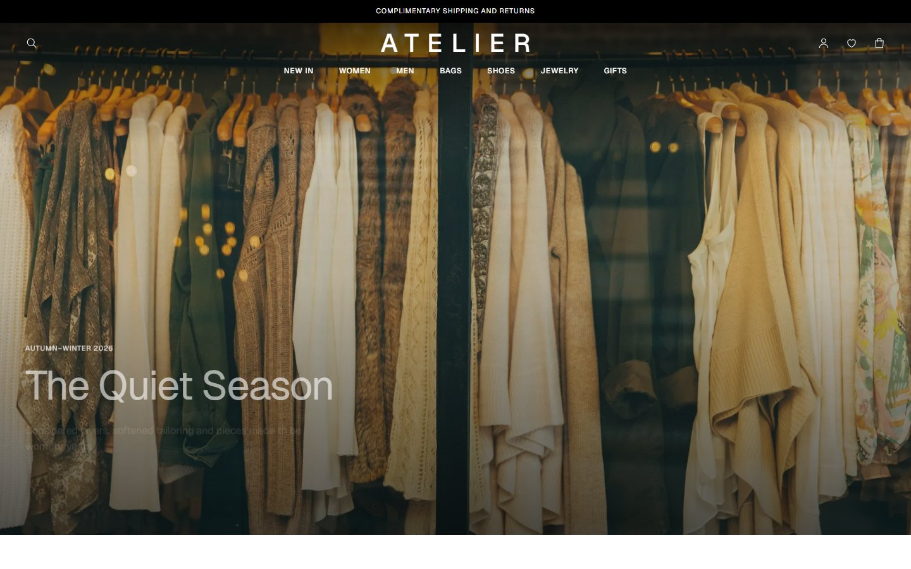
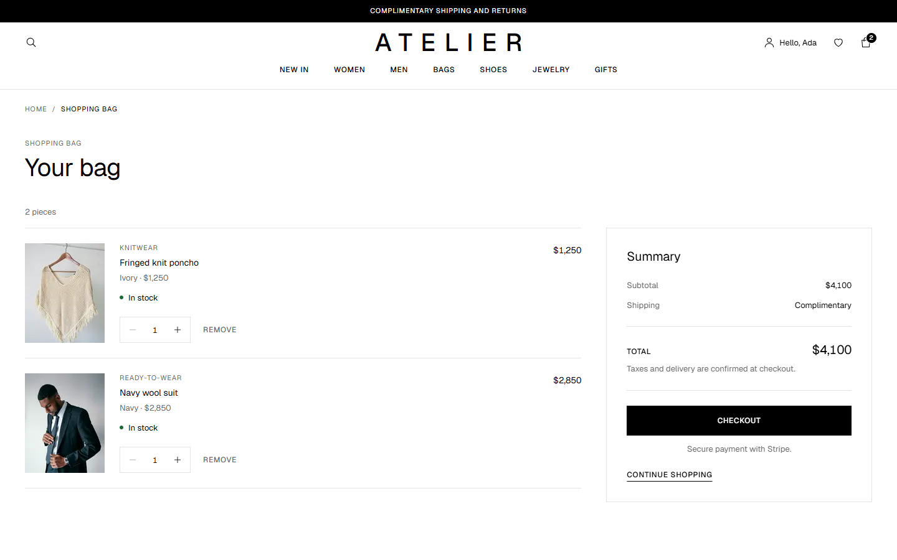
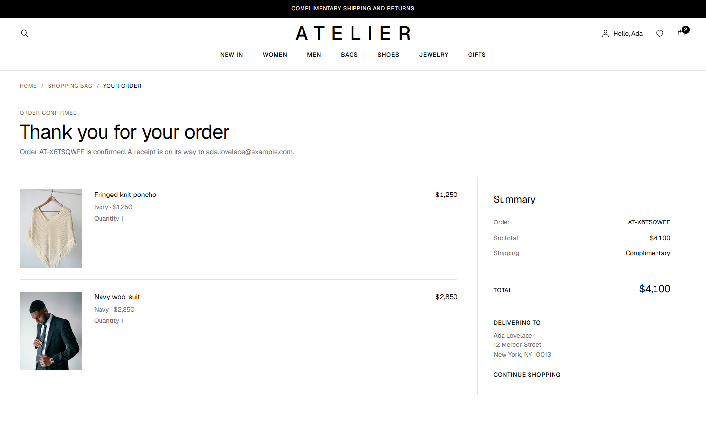
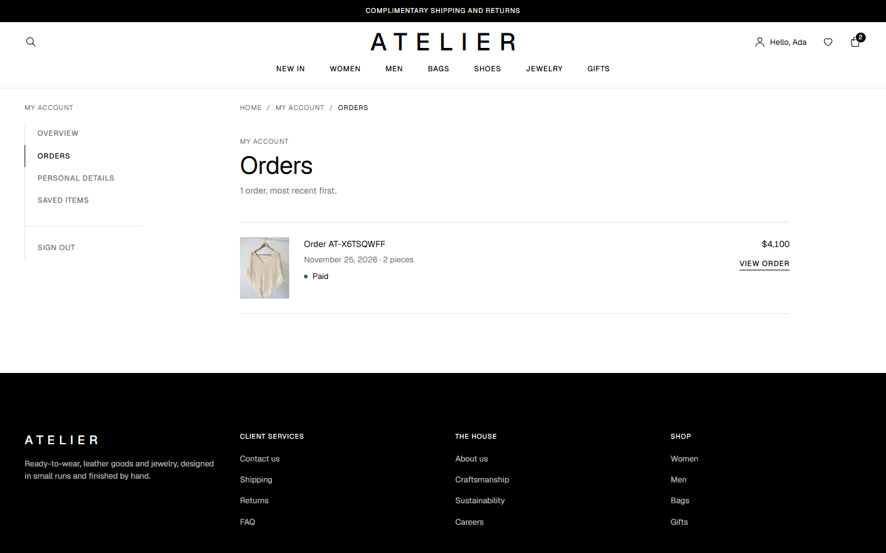
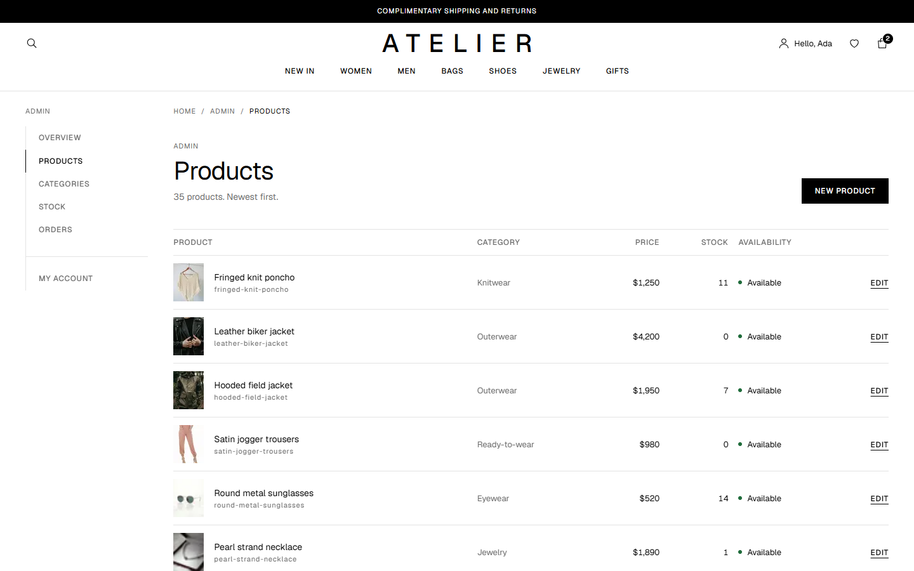
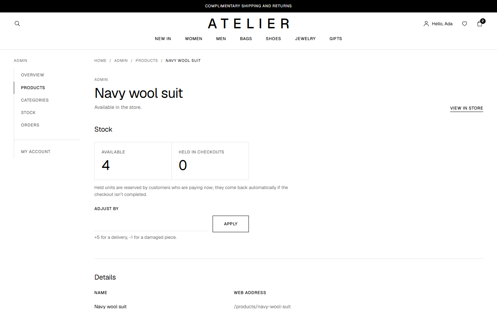
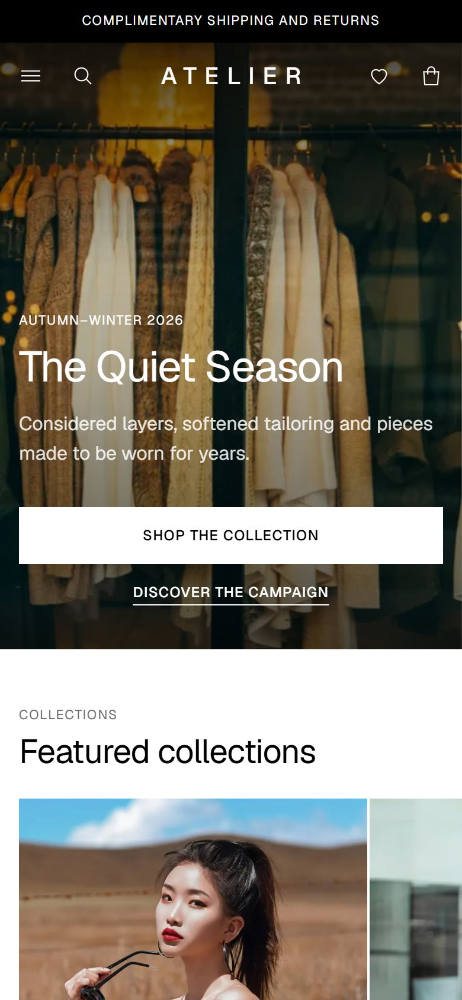
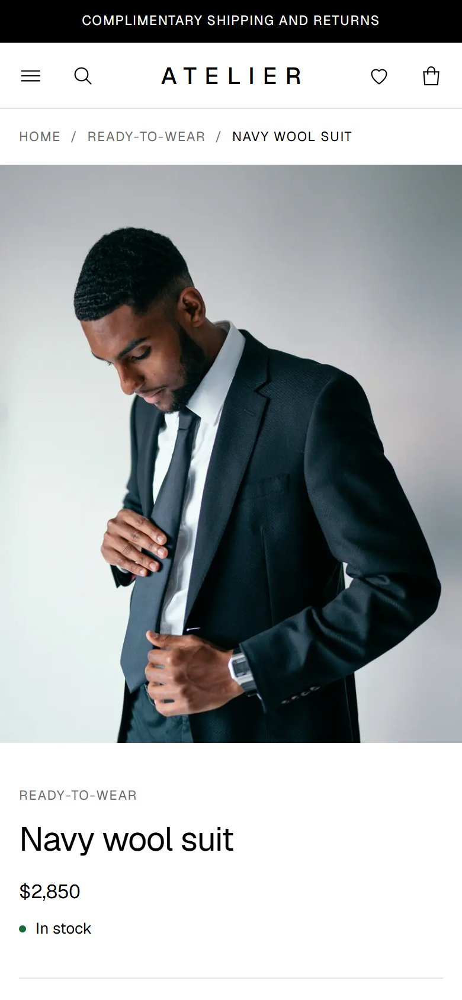
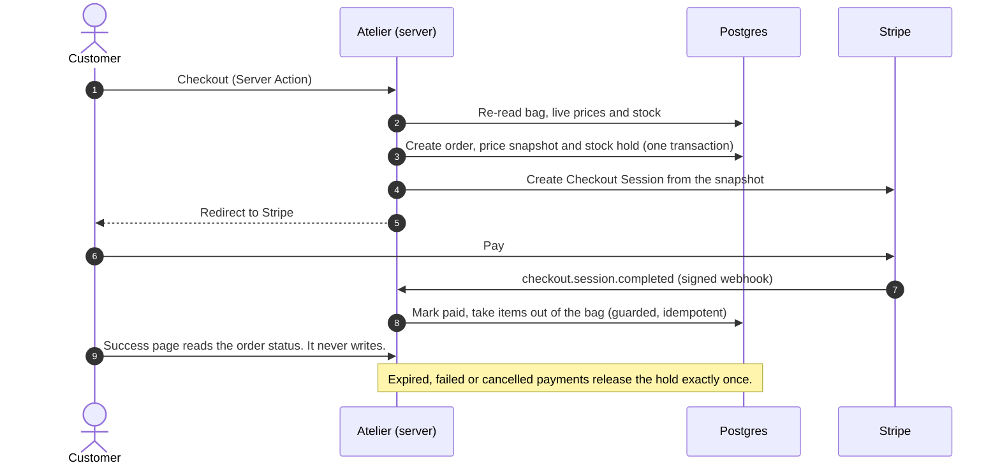

<div align="center">

# Atelier

**A luxury fashion storefront with real checkout, order history and an admin back office.**

[](https://github.com/PLAYER303GOD/atelier-store/actions/workflows/ci.yml)




</div>

## Overview

Atelier is a full-stack e-commerce store built on the Next.js 16 App Router. Customers browse an editorial catalogue, keep a shopping bag across devices, pay through Stripe Checkout and follow their orders. Staff manage products, categories, stock and orders from a protected admin area.

The interesting parts are underneath. Prices and stock never come from the browser. Stock is held atomically while a customer pays. Payment is confirmed only by a signed Stripe webhook. Every admin entry point checks the role on the server, and CI enforces that.

## Features

**Storefront**
- Editorial homepage, category and collection listings, search, and product pages with image galleries
- Full-bleed campaign heroes with a transparent header, view transitions, and reduced-motion support
- "Save for later" items and a responsive layout from 375px up

**Shopping bag**
- Guest bags (httpOnly cookie) that merge into the account bag at sign-in
- Live prices and stock on every render: lines that are short of stock or sold out are flagged, and quantities are clamped in SQL so simultaneous clicks can't oversell

**Checkout and payments**
- Stripe-hosted Checkout, built only from a server-side order snapshot: no client prices, no `payment_method_types`
- Stock is held when checkout starts and released exactly once if payment fails, expires or is cancelled
- One open checkout per customer, and no new checkout while an earlier payment may still be clearing (no double charges)
- A signed, idempotent webhook marks orders paid, processing, failed or expired, and the success page only reads that state

**Accounts**
- Email and password sign-in with Better Auth, and 30-day sliding sessions
- Order history and order details, each scoped to the signed-in customer on the server

**Admin back office** (`/admin`)
- Products: create and edit them with live image previews, change price and category, and set them available or hidden
- Categories: add, rename, and delete only while unused. Reserved URLs are refused.
- Stock: atomic +/- adjustments that never go below zero, plus units currently held by open checkouts
- Orders: all customers' orders with status filters, plus payment details and Stripe IDs

## Screenshots

| Product page | Shopping bag |
| --- | --- |
|  |  |
| **Order confirmation** | **Order history** |
|  |  |
| **Admin: products** | **Admin: edit product** |
|  |  |

<p align="center">
  
  &nbsp;&nbsp;
  
</p>

## Tech stack

| Layer | Choice |
| --- | --- |
| Framework | Next.js 16 (App Router, Cache Components, partial prefetching), React 19 |
| Language | TypeScript |
| Styling | Tailwind CSS v4 with a custom design-token theme |
| Database | Neon Postgres, Drizzle ORM with SQL migrations |
| Auth | Better Auth (email and password, Drizzle adapter) |
| Payments | Stripe Checkout and webhooks |
| Tooling | pnpm, ESLint, GitHub Actions |

## How checkout works



## Security and data integrity

- **The server decides.** Prices, totals and stock come from Postgres. The only thing the checkout form sends is a fingerprint of the bag it rendered, used to refuse checkout if the bag changed, never to price anything.
- **The database enforces what the code relies on.** Check constraints keep prices and stock at zero or above, so a stock hold that would oversell fails the whole transaction. A partial unique index allows at most one open checkout per customer.
- **Webhooks are verified and idempotent.** Signatures are checked on the raw body. Each order change is a guarded single statement, so retried, duplicate or out-of-order events change nothing twice.
- **Admin access is checked on the server, every time.** Every admin page awaits `requireAdmin()`, and every admin Server Action starts with `getAdminForAction()`, with the role read fresh. Non-admins get a 404. `pnpm check:admin` fails the build if any admin page or action skips its check, and CI runs it on every push.
- **Customers only see their own data.** Order queries filter by the signed-in user's id in SQL. Hidden products disappear from every storefront read, the bag and checkout.

## Getting started

### Prerequisites

- Node.js 20.12+ (CI uses Node 24) and [pnpm](https://pnpm.io) 12
- A [Neon](https://neon.tech) (or any) Postgres database
- A [Stripe](https://stripe.com) sandbox account and the [Stripe CLI](https://docs.stripe.com/stripe-cli), for checkout

### Setup

```bash
pnpm install
cp .env.example .env.local        # then fill in the values below
pnpm db:migrate && pnpm db:seed   # schema + sample catalogue
pnpm dev --port 3001
```

| Variable | Purpose |
| --- | --- |
| `DATABASE_URL` | Postgres connection string |
| `BETTER_AUTH_SECRET` | Random secret for session signing |
| `BETTER_AUTH_URL` | The app's origin, e.g. `http://localhost:3001` (must match the dev server) |
| `STRIPE_SECRET_KEY` | Stripe sandbox key (a restricted `rk_…` key with Checkout Sessions write is enough) |
| `STRIPE_WEBHOOK_SECRET` | `whsec_…` from `stripe listen --print-secret` |
| `APP_URL` | Optional origin for Stripe's return URLs (defaults to `BETTER_AUTH_URL`) |

### Payments locally

```bash
stripe login
pnpm stripe:listen            # forwards Checkout events and reports each delivery
```

Pay with the test card `4242 4242 4242 4242`. If an event wasn't delivered, `pnpm stripe:replay evt_…` resends it.

### Admin access

Roles can't be set from the browser. Promote an existing account from the command line:

```bash
pnpm auth:make-admin you@example.com            # --revoke to undo
```

Then open `/admin`.

## Scripts

| Script | What it does |
| --- | --- |
| `pnpm dev` / `build` / `start` | Develop, build and serve |
| `pnpm lint` / `typecheck` | ESLint, and `next typegen` + `tsc` |
| `pnpm check:admin` | Fails if any admin page, route handler or action skips the server-side role check |
| `pnpm db:generate` / `db:migrate` | Create and apply SQL migrations (`drizzle/`) |
| `pnpm db:seed` | Load the sample catalogue (idempotent) |
| `pnpm auth:make-admin <email>` | Grant or revoke the admin role |
| `pnpm stripe:listen` / `stripe:replay` | Local Stripe webhook forwarding and replays |
| `pnpm orders:release-expired` | Release holds from checkouts that never reached Stripe (run on a schedule) |

## Project structure

```
src/
  app/              routes: storefront, bag, checkout, account, admin, API (auth, products, Stripe webhook)
  components/       ui/ primitives, product, cart, order, account, admin, site chrome
  db/               Drizzle schema (catalogue, cart, orders, auth) and seed data
  lib/              server-only queries, Server Actions, validation, session and role checks
drizzle/            SQL migrations
scripts/            admin guard check, Stripe dev helpers
docs/screenshots/   README images
```

## Quality

- **CI** (`.github/workflows/ci.yml`) runs ESLint, the TypeScript check and `check:admin` on every push and pull request.
- **Changes are verified end to end before they're committed:** against the real database and in headless Chrome at phone, tablet and desktop widths. That includes replaying captured admin requests as a customer to confirm they're refused.
- **Not yet built:** an automated test suite, transactional email (order confirmations, password reset), product variants, and 2FA for admins.

## License

Copyright © 2026. All rights reserved. This repository is published for viewing. No license is granted to copy, modify or distribute the code.
